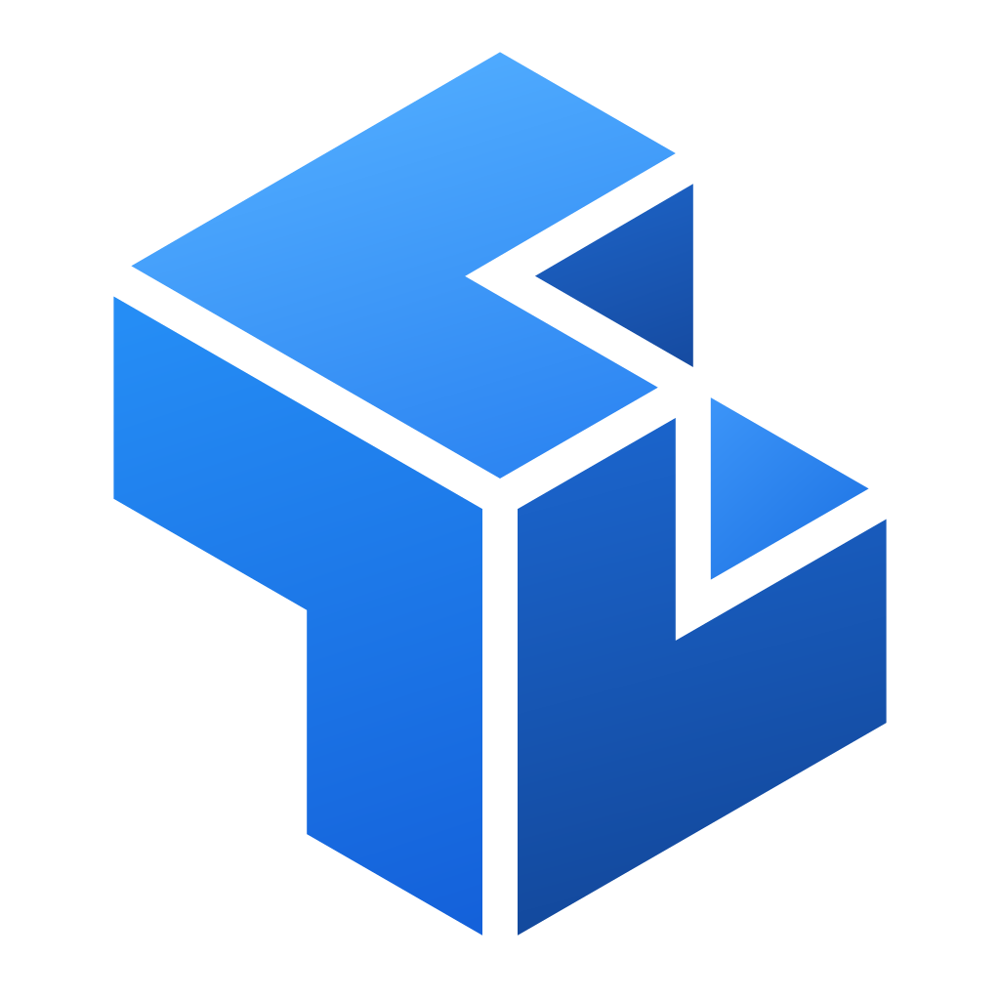

# dockercraft-casaos

An unofficial [CasaOS](https://casaos.zimaspace.com/) app store for the **Craft** applications: open-source, clean-room reimplementations of well-known creative and office applications, rebuilt in pure Rust and served in your browser.

> **Application credits:**
> - **ArtCraft applications:** Developed by the [ArtCraft Team](https://getartcraft.com) and their respective contributors.
> - **SolidCraft:** Developed by [Tangency Labs](https://solidcraft.io) and its contributors.
>
> This repository only packages their work for CasaOS. It is not an official ArtCraft or Tangency Labs repository.

## Install

1. Open the CasaOS dashboard and go to **App Store**.
2. Click **Add Source** and paste:

   ```
   https://github.com/berg-maia/dockercraft-casaos/archive/refs/heads/main.zip
   ```

3. Pick an app from the new source and install it. Open it at `http://<your-server-ip>:<port>` using the port from the table bellow.

Each app uses its own host port, so all of them can run side by side.

> **Note:** If newly added applications do not appear in the CasaOS App Store, even after removing and re-adding the repository, try restarting the CasaOS App Management service.
>
> **Via SSH:**
> Connect to your CasaOS device via SSH and run:
   ```
   sudo systemctl restart casaos-app-management
   ```

## Apps

| App | What it is | Release | Official Links | Port |
|:---:|---|:---:|:---:|---:|
| <div align="center"><br><b>PhotoCraft</b></div> | Image editing; a reimplementation of Adobe Photoshop | <div align="center"><br></div> | [](https://getartcraft.com/apps/photocraft) [](https://github.com/storytold/photocraft) | 8765 |
| <div align="center"><br><b>VectorCraft</b></div> | Vector illustration; a reimplementation of Adobe Illustrator | <div align="center"><br></div> | [](https://getartcraft.com/apps/vectorcraft) [](https://github.com/storytold/vectorcraft) | 8766 |
| <div align="center"><br><b>FilmCraft</b></div> | Video editing, color and sound; a reimplementation of Adobe Premiere Pro | <div align="center"><br></div> | [](https://getartcraft.com/apps/filmcraft) [](https://github.com/storytold/filmcraft) | 8767 |
| <div align="center"><br><b>LightCraft</b></div> | Photo library and raw development; a reimplementation of Adobe Lightroom | <div align="center"><br></div> | [](https://getartcraft.com/apps/lightcraft) [](https://github.com/storytold/lightcraft) | 8768 |
| <div align="center"><br><b>PdfCraft</b></div> | The PDF workbench; a reimplementation of Adobe Acrobat | <div align="center"><br></div> | [](https://getartcraft.com/apps/pdfcraft) [](https://github.com/storytold/pdfcraft) | 8769 |
| <div align="center"><br><b>EffectCraft</b></div> | Motion graphics and visual effects; a reimplementation of Adobe After Effects | <div align="center"><br></div> | [](https://getartcraft.com/apps/effectcraft) [](https://github.com/storytold/effectcraft) | 8770 |
| <div align="center"><br><b>DesignCraft</b></div> | Page layout and publishing; a reimplementation of Adobe InDesign | <div align="center"><br></div> | [](https://getartcraft.com/apps/designcraft) [](https://github.com/storytold/designcraft) | 8771 |
| <div align="center"><br><b>FigCraft</b></div> | Interface design; a reimplementation of Figma | <div align="center"><br></div> | [](https://getartcraft.com/apps/figcraft) [](https://github.com/storytold/figcraft) | 8772 |
| <div align="center"><br><b>WordCraft</b></div> | Writing and document design; a reimplementation of Microsoft Word | <div align="center"><br></div> | [](https://getartcraft.com/apps/wordcraft) [](https://github.com/storytold/wordcraft) | 8773 |
| <div align="center"><br><b>SoundCraft</b></div> | Recording, editing and mixing audio; a reimplementation of Avid Pro Tools | <div align="center"><br></div> | [](https://getartcraft.com/apps/soundcraft) [](https://github.com/storytold/soundcraft) | 8774 |
| <div align="center"><br><b>DeckCraft</b></div> | Presentations and slide shows; a reimplementation of Microsoft PowerPoint | <div align="center"><br></div> | [](https://getartcraft.com/apps/deckcraft) [](https://github.com/storytold/deckcraft) | 8775 |
| <div align="center"><br><b>CADCraft</b></div> | Computer-aided design and drafting; a reimplementation of Autodesk AutoCAD | <div align="center"><br></div> | [](https://getartcraft.com/apps/cadcraft) [](https://github.com/storytold/cadcraft) | 8776 |
| <div align="center"><br><b>GridCraft</b></div> | Spreadsheets and data; a reimplementation of Microsoft Excel | <div align="center"><br></div> | [](https://getartcraft.com/apps/gridcraft) [](https://github.com/storytold/gridcraft) | 8777 |
| <div align="center"><br><b>Craft-Anything</b></div> | See how any website, app or game works, then have AI build your own version; an open-source, clean-room engine in pure Rust | <div align="center"><br></div> | [](https://getartcraft.com/apps/craft-anything) [](https://github.com/storytold/craft-anything) | 8778 |
| <div align="center"><br><b>TextureCraft</b></div> | Paint PBR materials straight onto your models in layers with masks, bake mesh maps, drive smart materials from them and export textures for any engine | <div align="center"><br></div> | [](https://getartcraft.com/apps/texturecraft) [](https://github.com/storytold/texturecraft) | 8779 |
| <div align="center"><br><b>SolidCraft</b></div> | Create sketches, set dimensions, and build 3D parts with an editable feature history. Work in the editor or connect an AI agent through MCP. | <div align="center"><br></div> | [](https://solidcraft.io) [](https://github.com/tangency-labs/solidcraft) | 8764 |


App descriptions follow the official project descriptions. Open each app's website or repository for its full documentation.

## Credits and rights

- **Authors and contributors:** applications included in this repository are developed and maintained by their respective authors, teams, and organizations. Credits are listed below and updated as new projects are added:
  - **ArtCraft Team:** ArtCraft applications and contributions.
  - **Tangency Labs:** SolidCraft.
- **Licenses:** each application is distributed under its respective license. Please refer to the original project's repository for license information and applicable terms.
- **Names, logos and icons:** belong to their respective authors, developers, organizations, or rights holders.
- **Third-party trademarks:** product names and trademarks belong to their respective owners. They are mentioned solely for identification and descriptive purposes. This repository is not affiliated with or endorsed by these companies unless explicitly stated.

## Issues

Problems with installing an app from this store (ports, icons, versions, translations) belong in this repository's issues. Problems inside an application belong to the project's own repository.
