# dockercraft-casaos

An unofficial [CasaOS](https://casaos.zimaspace.com/) app store for the **ArtCraft** suite: open-source, clean-room reimplementations of well-known creative and office applications, rebuilt in pure Rust and served in your browser.

> **All credit for the applications goes to the [ArtCraft Team](https://getartcraft.com) and the contributors of each project.**
> This repository only packages their work for CasaOS. It is not an official ArtCraft repository.

- Website: <https://getartcraft.com>
- GitHub organization: <https://github.com/storytold>

## Install

1. Open the CasaOS dashboard and go to **App Store**.
2. Click **Add Source** and paste:

   ```
   https://github.com/berg-maia/dockercraft-casaos/archive/refs/heads/main.zip
   ```

3. Pick an app from the new source and install it. Open it at `http://<your-server-ip>:<port>` using the port from the table bellow.

Each app uses its own host port, so all of them can run side by side.

## Apps

| | App | What it is | Version | Released | Website | Source code | Port |
|:---:|---|---|:---:|:---:|---|---|---:|
|  | **PhotoCraft** | Image editing; a reimplementation of Adobe Photoshop |  |  | [getartcraft.com/apps/photocraft](https://getartcraft.com/apps/photocraft) | [storytold/photocraft](https://github.com/storytold/photocraft) | 8765 |
| 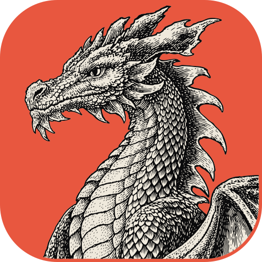 | **VectorCraft** | Vector illustration; a reimplementation of Adobe Illustrator |  |  | [getartcraft.com/apps/vectorcraft](https://getartcraft.com/apps/vectorcraft) | [storytold/vectorcraft](https://github.com/storytold/vectorcraft) | 8766 |
| 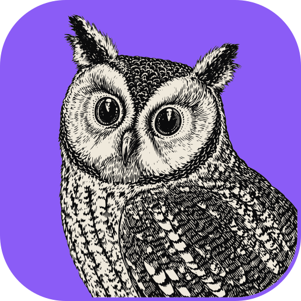 | **FilmCraft** | Video editing, color and sound; a reimplementation of Adobe Premiere Pro |  |  | [getartcraft.com/apps/filmcraft](https://getartcraft.com/apps/filmcraft) | [storytold/filmcraft](https://github.com/storytold/filmcraft) | 8767 |
| 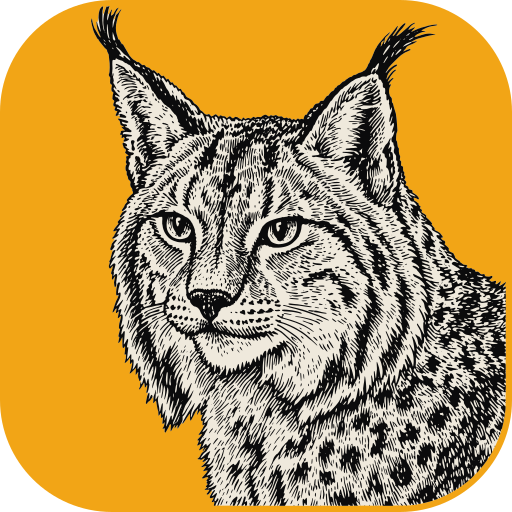 | **LightCraft** | Photo library and raw development; a reimplementation of Adobe Lightroom |  |  | [getartcraft.com/apps/lightcraft](https://getartcraft.com/apps/lightcraft) | [storytold/lightcraft](https://github.com/storytold/lightcraft) | 8768 |
| 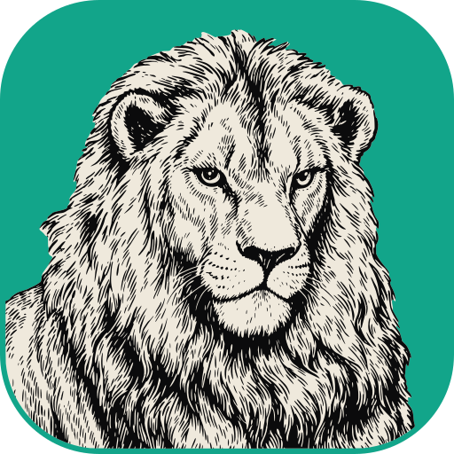 | **PdfCraft** | The PDF workbench; a reimplementation of Adobe Acrobat |  |  | [getartcraft.com/apps/pdfcraft](https://getartcraft.com/apps/pdfcraft) | [storytold/pdfcraft](https://github.com/storytold/pdfcraft) | 8769 |
| 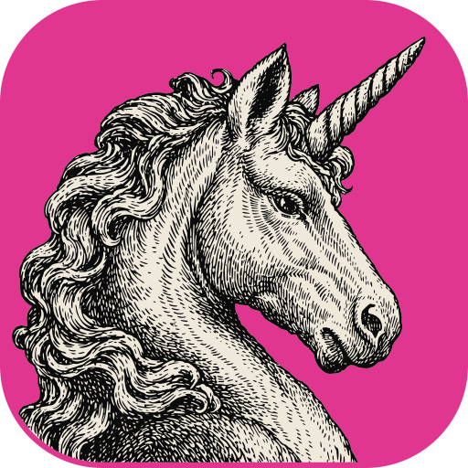 | **EffectCraft** | Motion graphics and visual effects; a reimplementation of Adobe After Effects |  |  | [getartcraft.com/apps/effectcraft](https://getartcraft.com/apps/effectcraft) | [storytold/effectcraft](https://github.com/storytold/effectcraft) | 8770 |
| 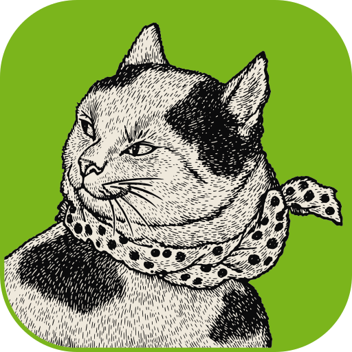 | **DesignCraft** | Page layout and publishing; a reimplementation of Adobe InDesign |  |  | [getartcraft.com/apps/designcraft](https://getartcraft.com/apps/designcraft) | [storytold/designcraft](https://github.com/storytold/designcraft) | 8771 |
| 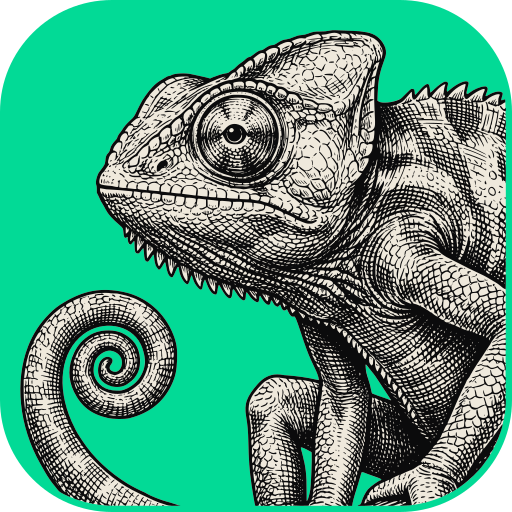 | **FigCraft** | Interface design; a reimplementation of Figma |  |  | [getartcraft.com/apps/figcraft](https://getartcraft.com/apps/figcraft) | [storytold/figcraft](https://github.com/storytold/figcraft) | 8772 |
| 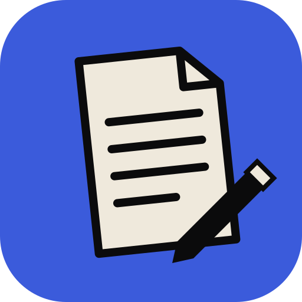 | **WordCraft** | Writing and document design; a reimplementation of Microsoft Word |  |  | [getartcraft.com/apps/wordcraft](https://getartcraft.com/apps/wordcraft) | [storytold/wordcraft](https://github.com/storytold/wordcraft) | 8773 |
| 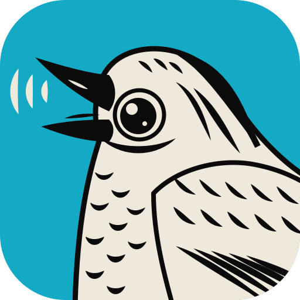 | **SoundCraft** | Recording, editing and mixing audio; a reimplementation of Avid Pro Tools |  |  | [getartcraft.com/apps/soundcraft](https://getartcraft.com/apps/soundcraft) | [storytold/soundcraft](https://github.com/storytold/soundcraft) | 8774 |
|  | **DeckCraft** | Presentations and slide shows; a reimplementation of Microsoft PowerPoint |  |  | [getartcraft.com/apps/deckcraft](https://getartcraft.com/apps/deckcraft) | [storytold/deckcraft](https://github.com/storytold/deckcraft) | 8775 |
| 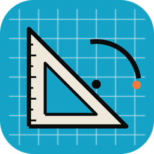 | **CADCraft** | Computer-aided design and drafting; a reimplementation of Autodesk AutoCAD |  |  | [getartcraft.com/apps/cadcraft](https://getartcraft.com/apps/cadcraft) | [storytold/cadcraft](https://github.com/storytold/cadcraft) | 8776 |
| 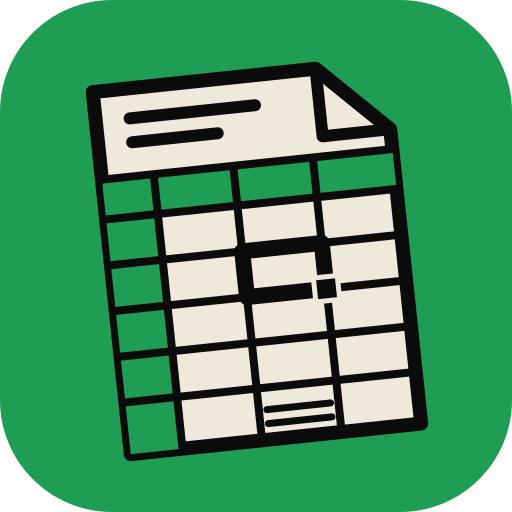 | **GridCraft** | Spreadsheets and data; a reimplementation of Microsoft Excel |  |  | [getartcraft.com/apps/gridcraft](https://getartcraft.com/apps/gridcraft) | [storytold/gridcraft](https://github.com/storytold/gridcraft) | 8777 |

App descriptions follow the official project descriptions. Open each app's website or repository for its full documentation.

## Credits and rights

- **Authors:** the applications are created by the **ArtCraft Team and the contributors of each project**. Please direct feature requests and application bugs to the project's own repository, linked in the table above.
- **License:** every ArtCraft project is open source under **MIT OR Apache-2.0**, with the copyright line "Copyright (c) 2026 ArtCraft Team and the *&lt;App&gt;* contributors". The license texts (`LICENSE-MIT`, `LICENSE-APACHE`) and the `NOTICE` file are in the root of each project's repository.
- **Names, icons and screenshots:** the app names, icons and screenshots belong to ArtCraft and its contributors. The icons are copied from each project's `assets/app-icon` folder, and the screenshots from its `docs/images` folder. Credits for the media shown inside the screenshots are kept by the projects in that same folder (for example `SOURCES.md` or `*.attribution` files).
- **What this repository contains:** only packaging for CasaOS (compose files, store metadata and GitHub Actions workflows). It does not contain or modify the source code of the applications. The Docker images are built from each project's official web release (`*-web-<version>.zip`) and served with nginx.
- **Third-party trademarks:** Adobe, Photoshop, Illustrator, Premiere Pro, Lightroom, Acrobat, After Effects and InDesign are trademarks of Adobe Inc.; Microsoft, Word, PowerPoint and Excel are trademarks of Microsoft Corporation; Figma is a trademark of Figma, Inc.; Avid and Pro Tools are trademarks of Avid Technology, Inc.; Autodesk and AutoCAD are trademarks of Autodesk, Inc. They are mentioned only to describe what each ArtCraft app reimplements, as in the projects' own descriptions. This store is not affiliated with or endorsed by any of these companies.

## Issues

Problems with installing an app from this store (ports, icons, versions, translations) belong in this repository's issues. Problems inside an application belong to the project's own repository.
